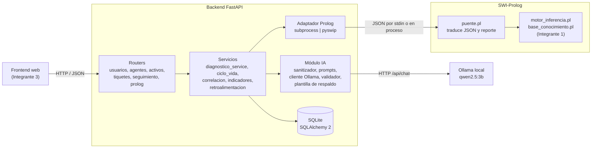
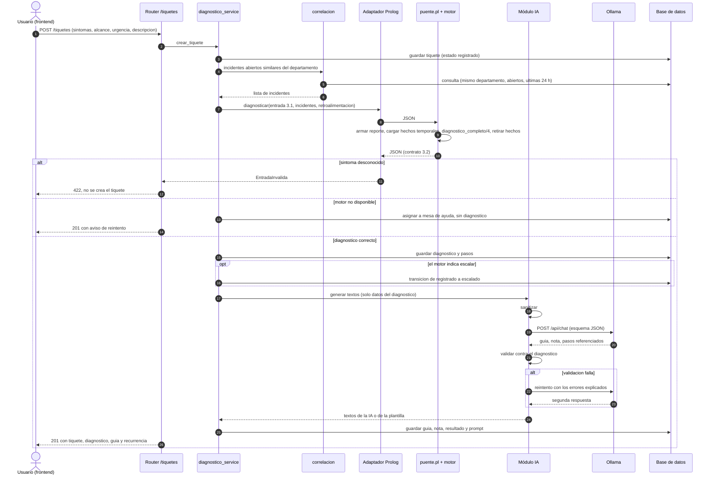

# Arquitectura del backend

## Descripción general

El backend es una aplicación FastAPI organizada en capas. Los *routers* reciben las peticiones HTTP y validan los datos con Pydantic; los servicios contienen la orquestación y las reglas de la aplicación; los modelos de SQLAlchemy representan la base de datos. Dos componentes externos completan el sistema: el motor de inferencia en SWI-Prolog, que concentra toda la lógica de diagnóstico, y el modelo de lenguaje local que se ejecuta en Ollama, que solo redacta textos a partir del diagnóstico.

El principio que organiza la arquitectura es la separación entre decidir y redactar. El motor Prolog decide las causas probables, los pasos, la prioridad, el SLA, la clasificación y el escalamiento. El backend no contiene reglas de diagnóstico: arma la entrada, transporta los datos y guarda los resultados. La IA no decide nada: convierte el diagnóstico en una guía para el usuario y una nota para el agente, y su respuesta se valida contra el diagnóstico antes de mostrarse.

## Diagrama de componentes



| Componente | Responsabilidad |
|---|---|
| Routers (`app/routers`) | Reciben las peticiones, validan los datos con Pydantic y traducen las excepciones de los servicios a códigos HTTP. |
| Servicios (`app/services`) | Orquestan el registro y el diagnóstico de tiquetes, aplican la máquina de estados, seleccionan incidentes para la correlación y calculan indicadores. |
| Adaptador Prolog (`app/prolog`) | Envía el tiquete en JSON al puente y recibe el diagnóstico en JSON. Tiene dos implementaciones intercambiables por configuración. |
| `puente.pl` | Traduce el contrato JSON a los átomos del motor, carga de forma temporal los incidentes abiertos y la retroalimentación, llama a `diagnostico_completo/4` y devuelve el resultado en JSON. |
| Base de conocimiento | Hechos y reglas del dominio (Integrante 1). Se reemplaza cambiando `PROLOG_KB`, sin modificar código. |
| Módulo IA (`app/ia`) | Sanitiza los datos, arma el prompt, consulta a Ollama, valida la respuesta y, si falla, genera los textos con una plantilla. |
| Base de datos | Usuarios, activos, tiquetes, diagnósticos, historial y retroalimentación. |

## Secuencia: registro de un tiquete



## Decisiones de diseño

**Puente en Prolog en lugar de traducción en Python.** La conversión entre el contrato JSON y el reporte que espera el motor (por ejemplo, que el alcance `departamento` se exprese con el dato de contexto `varios_usuarios_afectados`, o que `red_cableada` aporte la evidencia `usa_cable`) se escribió en Prolog. Así toda la lógica que depende del conocimiento del dominio queda en Prolog, y los dos adaptadores producen resultados idénticos porque solo transportan texto. Una prueba automática verifica esa equivalencia en nueve escenarios.

**Dos adaptadores.** El adaptador `subprocess` ejecuta SWI-Prolog como proceso independiente en cada consulta: es más lento, pero una falla del motor no afecta a la API. El adaptador `pyswip` carga la base una sola vez dentro del proceso de la API: es más rápido, pero requiere reiniciar la API si cambia la base y serializa las consultas con un candado, porque SWI-Prolog embebido no admite consultas simultáneas desde varios hilos.

**Hechos temporales.** Los incidentes abiertos y la retroalimentación se agregan a la base de conocimiento solo durante cada consulta y se retiran siempre al terminar, incluso si ocurre un error. Esto evita que una consulta contamine la siguiente.

**La IA redacta, no decide.** La IA recibe únicamente el diagnóstico estructurado, nunca el texto libre del usuario. Debe declarar qué pasos usa, y el validador verifica que existan en el diagnóstico, que estén escritos en la guía y que respeten el orden. La nota técnica combina un resumen redactado por la IA con los datos exactos del motor, de modo que siempre contiene la justificación de la prioridad.

**Máquina de estados explícita.** Las transiciones permitidas están en una tabla y cualquier otra se rechaza con 409. El historial registra cada cambio con fecha, agente y comentario.

## Tolerancia a fallos

| Falla | Comportamiento |
|---|---|
| SWI-Prolog no instalado o base inexistente | `/salud` informa `prolog: caido`. Al registrar un tiquete, este se guarda sin diagnóstico, asignado a la mesa de ayuda, y puede reintentarse. La consulta directa responde 503. |
| El motor no termina | Se interrumpe con `call_with_time_limit` (y con el tiempo límite del proceso en `subprocess`). Responde 504 o registra el tiquete sin diagnóstico. |
| Síntoma desconocido | Responde 422 con la lista de valores no reconocidos; no se crea el tiquete. |
| Ollama apagado o lento | El cliente reintenta una vez y, si vuelve a fallar, se usa la plantilla. El tiquete se registra con `resultado_ia = fallback`. |
| Respuesta de la IA inválida | Se reintenta una vez con los errores explicados al modelo; si vuelve a fallar, se usa la plantilla. |
| Base de conocimiento cambia de grupo | Si el motor asigna un grupo inexistente en la base de datos, el tiquete se registra sin diagnóstico y el problema queda en el registro de la aplicación. |

## Estructura del repositorio

```
backend/
├── app/
│   ├── main.py, config.py, database.py
│   ├── models/          modelos SQLAlchemy y valores enumerados
│   ├── schemas/         esquemas Pydantic (incluye los contratos 3.1 y 3.2)
│   ├── routers/         endpoints HTTP
│   ├── services/        orquestación, ciclo de vida, correlación, indicadores
│   ├── prolog/          adaptadores, puente.pl y base de conocimiento (kb/)
│   └── ia/              sanitizador, prompts, cliente, validador, plantilla
├── tests/               pruebas automáticas (pytest)
├── scripts/             seed, seed_tiquetes, demo, probar_ia, consulta_sql
└── docs/                documentación
```
