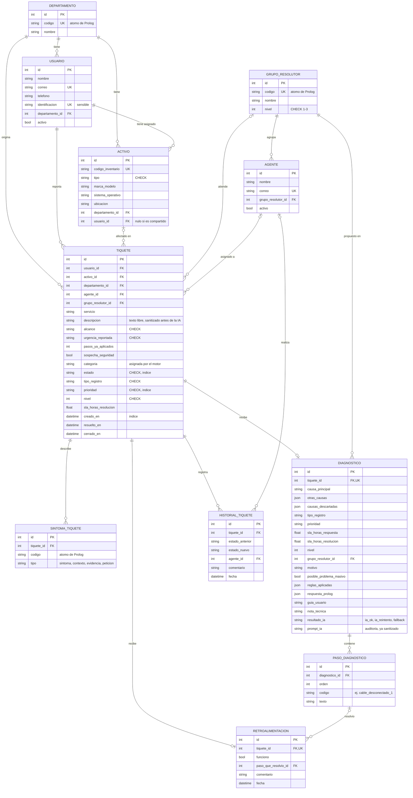

# Esquema de la base de datos

## Descripción general

La base de datos registra la estructura de la organización (departamentos, grupos resolutores, usuarios, agentes y activos), los tiquetes con su ciclo de vida, el diagnóstico que produce el motor de inferencia y la retroalimentación sobre las soluciones aplicadas. Se implementa con SQLAlchemy 2 sobre SQLite durante el desarrollo; el modelo usa únicamente tipos y restricciones estándar, por lo que es compatible con PostgreSQL cambiando la variable `DATABASE_URL`.

El diseño responde a cuatro criterios:

1. **Separación entre diagnóstico y estado vigente.** La tabla `diagnostico` conserva la respuesta del motor tal como se produjo al registrar el tiquete y no se modifica después. La tabla `tiquete` guarda los valores vigentes (prioridad, nivel, grupo, estado), que cambian al escalar o reasignar. De este modo puede auditarse qué decidió el motor y qué hicieron después los agentes.
2. **Códigos compartidos con el motor.** Los departamentos, los grupos resolutores y los datos del reporte se identifican con los mismos átomos que usa la base de conocimiento en Prolog. Una prueba automática verifica que los grupos de la base de datos coincidan con los del motor.
3. **Integridad en la base, no solo en el código.** Los valores enumerados se protegen con restricciones `CHECK`, las relaciones con claves foráneas (que en SQLite se activan en cada conexión) y los datos únicos con restricciones de unicidad. Ningún camino de la aplicación puede guardar un estado, una prioridad o un nivel inválidos.
4. **Identificación de datos sensibles.** Los campos que contienen datos personales (nombre, correo, teléfono e identificación del usuario, y la descripción libre del tiquete) están documentados como tales. Ninguno se envía a la IA.

Todas las fechas se almacenan en UTC. Un tipo de columna propio (`FechaUTC`) convierte a UTC al guardar y agrega la zona horaria al leer, porque SQLite no conserva la zona horaria y, sin esa conversión, una fecha en UTC se interpretaría como hora local.

## Diagrama entidad-relación

## Diccionario de datos

### departamento

Área de la organización.

| Columna | Tipo | Nulo | Clave | Descripción |
|---|---|---|---|---|
| id | entero | no | PK | Identificador. |
| codigo | texto (50) | no | única | Código único; coincide con el átomo de Prolog (ej. finanzas). |
| nombre | texto (100) | no |  | Nombre visible. |

### grupo_resolutor

Equipo que atiende los casos, con su nivel de soporte.

| Columna | Tipo | Nulo | Clave | Descripción |
|---|---|---|---|---|
| id | entero | no | PK | Identificador. |
| codigo | texto (50) | no | única | Código único; coincide con el átomo de Prolog (ej. redes). |
| nombre | texto (100) | no |  | Nombre visible. |
| nivel | entero | no |  | Nivel de soporte: 1, 2 o 3. |
| descripcion | texto (255) | sí |  | Alcance del grupo. |

Restricciones CHECK: `nivel IN (1, 2, 3)`.

### usuario

Persona que reporta incidentes o solicitudes.

| Columna | Tipo | Nulo | Clave | Descripción |
|---|---|---|---|---|
| id | entero | no | PK | Identificador. |
| nombre | texto (120) | no |  | Nombre completo. Dato personal: no se envia a la IA. |
| correo | texto (120) | no | única | Correo único, en minúsculas. Dato personal. |
| telefono | texto (30) | sí |  | Teléfono. Dato personal. |
| identificacion | texto (30) | sí | única | Cédula física X-XXXX-XXXX, única. Dato sensible. |
| departamento_id | entero | no | FK departamento, índice | Departamento al que pertenece. |
| activo | booleano | no |  | Falso si el usuario fue desactivado. |
| creado_en | fecha y hora (UTC) | no |  | Fecha de registro (UTC). |

### agente

Persona de soporte que atiende tiquetes.

| Columna | Tipo | Nulo | Clave | Descripción |
|---|---|---|---|---|
| id | entero | no | PK | Identificador. |
| nombre | texto (120) | no |  | Nombre completo. |
| correo | texto (120) | no | única | Correo único. |
| grupo_resolutor_id | entero | no | FK grupo_resolutor, índice | Grupo al que pertenece. |
| activo | booleano | no |  | Falso si fue desactivado. |
| creado_en | fecha y hora (UTC) | no |  | Fecha de registro (UTC). |

### activo

Equipo tecnológico de la organización.

| Columna | Tipo | Nulo | Clave | Descripción |
|---|---|---|---|---|
| id | entero | no | PK | Identificador. |
| codigo_inventario | texto (30) | no | única | Código único con formato AAA-000. |
| tipo | texto (20) | no |  | laptop, escritorio, impresora, telefono, servidor u otro. |
| marca_modelo | texto (100) | no |  | Marca y modelo. |
| sistema_operativo | texto (60) | sí |  | Sistema operativo, si aplica. |
| ubicacion | texto (100) | no |  | Ubicación física. |
| departamento_id | entero | no | FK departamento, índice | Departamento propietario. |
| usuario_id | entero | sí | FK usuario, índice | Usuario asignado; nulo si es un equipo compartido. |
| creado_en | fecha y hora (UTC) | no |  | Fecha de registro (UTC). |

Restricciones CHECK: `tipo IN ('laptop', 'escritorio', 'impresora', 'telefono', 'servidor', 'otro')`.

### tiquete

Caso reportado y su estado vigente. Los valores de diagnóstico pueden cambiar al escalar o reasignar; el diagnóstico original queda en la tabla diagnóstico.

| Columna | Tipo | Nulo | Clave | Descripción |
|---|---|---|---|---|
| id | entero | no | PK | Identificador. |
| usuario_id | entero | no | FK usuario, índice | Usuario que reporta. |
| activo_id | entero | sí | FK activo, índice | Equipo afectado, si se indico. |
| departamento_id | entero | no | FK departamento, índice | Departamento del usuario al momento del reporte; se usa en la correlación. |
| agente_id | entero | sí | FK agente, índice | Agente que atiende el caso actualmente. |
| grupo_resolutor_id | entero | sí | FK grupo_resolutor, índice | Grupo asignado actualmente. |
| servicio | texto (50) | no |  | Servicio afectado (ej. red, correo). |
| componente | texto (50) | sí |  | Componente; red_cableada o red_inalambrica aportan evidencia al motor. |
| descripcion | texto largo | sí |  | Texto libre del usuario. Puede contener datos sensibles: nunca se envia a la IA. |
| alcance | texto (20) | no |  | individual, departamento u organización, según el usuario. |
| urgencia_reportada | texto (10) | no |  | Urgencia indicada por el usuario: baja, media o alta. |
| pasos_ya_aplicados | entero | no |  | Cantidad de pasos que el usuario ya aplico. |
| sospecha_seguridad | booleano | no |  | Verdadero si hay indicios de un incidente de seguridad. |
| categoria | texto (50) | sí | índice | Categoría asignada por el motor; se usa para detectar recurrencia. |
| estado | texto (20) | no | índice | registrado, en_atencion, escalado, resuelto o cerrado. |
| tipo_registro | texto (30) | sí |  | incidente, solicitud_servicio o problema. |
| prioridad | texto (2) | sí | índice | p1 a p4. |
| nivel | entero | sí |  | Nivel de soporte vigente: 1, 2 o 3. |
| sla_horas_resolucion | decimal | sí |  | Horas hábiles para resolver según la prioridad. |
| creado_en | fecha y hora (UTC) | no | índice | Fecha de registro (UTC). |
| actualizado_en | fecha y hora (UTC) | no |  | Fecha del último cambio (UTC). |
| resuelto_en | fecha y hora (UTC) | sí |  | Fecha de resolución (UTC); se borra si el caso se reabre. |
| cerrado_en | fecha y hora (UTC) | sí |  | Fecha de cierre (UTC). |

Restricciones CHECK: `estado IN ('registrado', 'en_atencion', 'escalado', 'resuelto', 'cerrado')`; `tipo_registro IS NULL OR tipo_registro IN ('incidente', 'solicitud_servicio', 'problema')`; `pasos_ya_aplicados >= 0`; `nivel IS NULL OR nivel IN (1, 2, 3)`; `prioridad IS NULL OR prioridad IN ('p1', 'p2', 'p3', 'p4')`; `alcance IN ('individual', 'departamento', 'organizacion')`; `urgencia_reportada IN ('baja', 'media', 'alta')`.

Índices compuestos: ix_tiquete_depto_estado (departamento_id, estado).

### sintoma_tiquete

Datos del reporte: síntomas, contexto, evidencias y peticiones, como átomos del motor.

| Columna | Tipo | Nulo | Clave | Descripción |
|---|---|---|---|---|
| id | entero | no | PK | Identificador. |
| tiquete_id | entero | no | FK tiquete, índice | Tiquete al que pertenece. |
| codigo | texto (60) | no | índice | Átomo de la base de conocimiento (ej. sin_internet). |
| tipo | texto (20) | no |  | síntoma, contexto, evidencia o petición, según el catálogo del motor. |

Restricciones CHECK: `tipo IN ('sintoma', 'contexto', 'evidencia', 'peticion')`.

Unicidad compuesta: (tiquete_id, codigo).

### diagnostico

Resultado del motor de inferencia al registrar el tiquete. No se modifica después: es la evidencia de cada decisión. Incluye la guía y la nota generadas.

| Columna | Tipo | Nulo | Clave | Descripción |
|---|---|---|---|---|
| id | entero | no | PK | Identificador. |
| tiquete_id | entero | no | FK tiquete, única | Tiquete diagnosticado (uno por tiquete). |
| causa_principal | texto (60) | no |  | Causa más probable, o sin_determinar. |
| otras_causas | JSON | no |  | Demás causas en orden de probabilidad (JSON). |
| causas_descartadas | JSON | no |  | Causas descartadas con su motivo (JSON). |
| tipo_registro | texto (30) | no |  | Clasificación del motor. |
| impacto | texto (20) | no |  | Impacto inferido. |
| urgencia | texto (10) | no |  | Urgencia inferida. |
| prioridad | texto (2) | no |  | Prioridad según la matriz. |
| sla_horas_respuesta | decimal | no |  | Horas hábiles para la primera respuesta. |
| sla_horas_resolucion | decimal | no |  | Horas hábiles para resolver. |
| nivel | entero | no |  | Nivel de atención decidido. |
| grupo_resolutor_id | entero | no | FK grupo_resolutor | Grupo decidido por el motor. |
| motivo | texto largo | no |  | Justificación de la decisión de atención. |
| posible_problema_masivo | booleano | no |  | Verdadero si el motor detecto un problema masivo. |
| incidentes_relacionados | JSON | no |  | Tiquetes abiertos relacionados (JSON). |
| reglas_aplicadas | JSON | no |  | Reglas que decidieron el caso (JSON). |
| respuesta_prolog | JSON | no |  | Respuesta completa del motor, para auditoría (JSON). |
| guia_usuario | texto largo | sí |  | Guía para el usuario (IA o plantilla). |
| nota_tecnica | texto largo | sí |  | Nota para el agente (IA y datos del motor). |
| resultado_ia | texto (15) | sí |  | ia_ok, ia_reintento o fallback. |
| prompt_ia | texto largo | sí |  | Mensajes enviados a la IA, ya sanitizados. |
| creado_en | fecha y hora (UTC) | no |  | Fecha del diagnóstico (UTC). |

Restricciones CHECK: `impacto IN ('individual', 'departamento', 'organizacion')`; `tipo_registro IN ('incidente', 'solicitud_servicio', 'problema')`; `resultado_ia IS NULL OR resultado_ia IN ('ia_ok', 'ia_reintento', 'fallback')`; `urgencia IN ('baja', 'media', 'alta')`; `prioridad IN ('p1', 'p2', 'p3', 'p4')`; `nivel IN (1, 2, 3)`.

### paso_diagnostico

Pasos de solución del diagnóstico, en orden.

| Columna | Tipo | Nulo | Clave | Descripción |
|---|---|---|---|---|
| id | entero | no | PK | Identificador. |
| diagnostico_id | entero | no | FK diagnostico, índice | Diagnóstico al que pertenece. |
| orden | entero | no |  | Posición del paso, desde 1. |
| codigo | texto (80) | no | índice | Identificador generado por el motor (ej. cable_desconectado_1). |
| texto | texto largo | no |  | Instrucción. |

Restricciones CHECK: `orden >= 1`.

Unicidad compuesta: (diagnostico_id, orden).

### historial_tiquete

Cambios de estado del tiquete.

| Columna | Tipo | Nulo | Clave | Descripción |
|---|---|---|---|---|
| id | entero | no | PK | Identificador. |
| tiquete_id | entero | no | FK tiquete, índice | Tiquete. |
| estado_anterior | texto (20) | sí |  | Estado previo; nulo en el registro inicial. |
| estado_nuevo | texto (20) | no |  | Estado al que paso. |
| agente_id | entero | sí | FK agente | Agente que hizo el cambio; nulo si lo hizo el sistema. |
| comentario | texto largo | sí |  | Comentario del cambio. |
| fecha | fecha y hora (UTC) | no | índice | Fecha del cambio (UTC). |

Restricciones CHECK: `estado_nuevo IN ('registrado', 'en_atencion', 'escalado', 'resuelto', 'cerrado')`; `estado_anterior IS NULL OR estado_anterior IN ('registrado', 'en_atencion', 'escalado', 'resuelto', 'cerrado')`.

### retroalimentacion

Resultado de la solución aplicada; alimenta al motor en los diagnosticos siguientes.

| Columna | Tipo | Nulo | Clave | Descripción |
|---|---|---|---|---|
| id | entero | no | PK | Identificador. |
| tiquete_id | entero | no | FK tiquete, única | Tiquete (una retroalimentacion por tiquete). |
| funciono | booleano | no |  | Verdadero si la solución resolvio el caso. |
| paso_que_resolvio_id | entero | sí | FK paso_diagnostico | Paso del diagnóstico que resolvio, si se indico. |
| comentario | texto largo | sí |  | Comentario del usuario o del agente. |
| fecha | fecha y hora (UTC) | no |  | Fecha de registro (UTC). |
